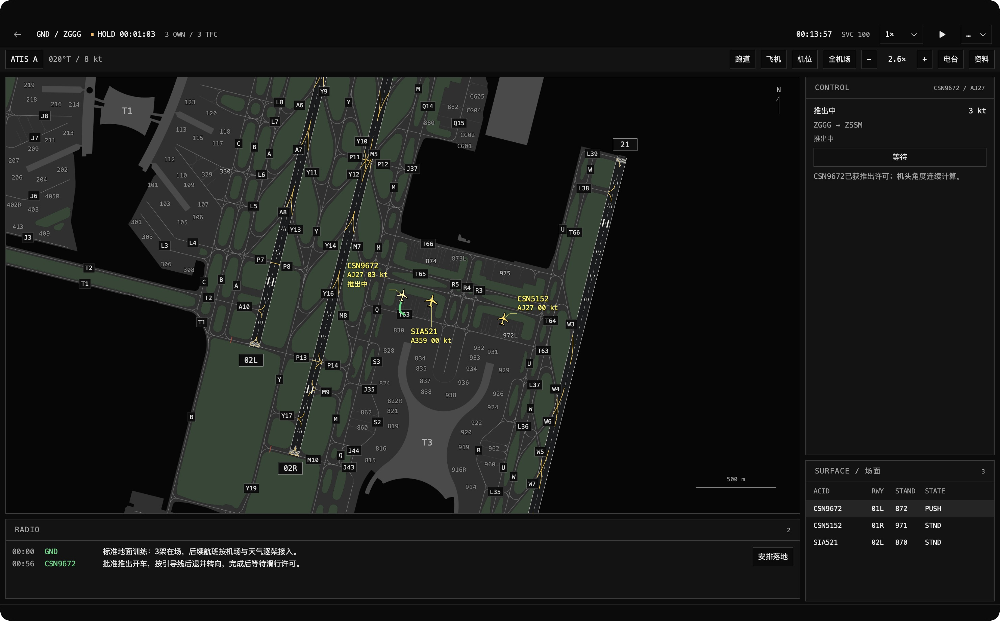
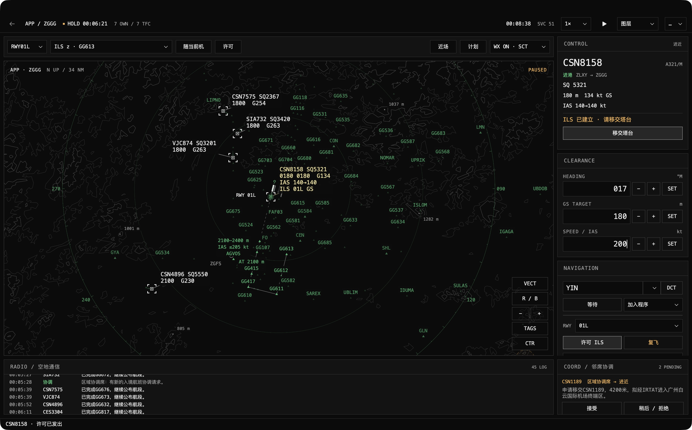
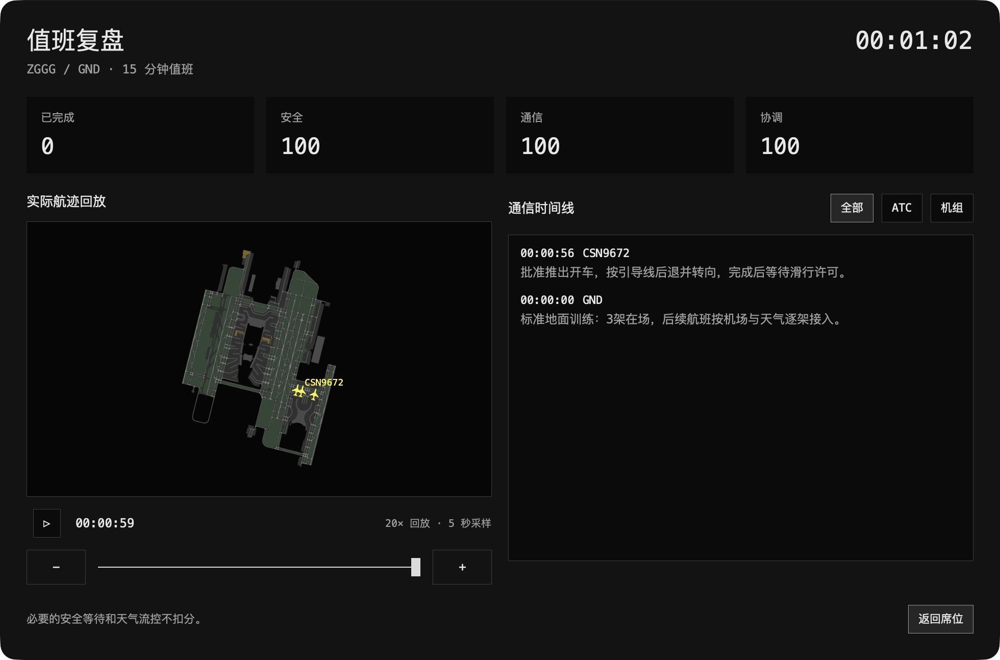

# ATC Sim

**A native macOS air traffic control game.** Manage airport surface movement, sequence arrivals and departures, and coordinate aircraft through an area-control sector.

[How to play](docs/HOW_TO_PLAY.md) · [Release history](CHANGELOG.md) · [GitHub Releases](https://github.com/lucaschen-dev/ATC-Sim/releases) · [Traffic schedules](docs/TRAFFIC_SCHEDULES.md) · [Report a bug](docs/BUG_REPORTING.md)

**Current documented version: v1.1 · Build 49.** The current local build targets **macOS 26 or later on Apple silicon**. The interface supports English and Simplified Chinese.

This repository is the public player guide and development release archive. It contains documentation, game screenshots and fictional CSV training schedules. **The game application, installers, private source code, player saves and source-chart PDFs are not hosted here.** No public download is announced in this repository. GitHub's automatically generated “Source code” archives contain these documentation files only.

## The game

ATC Sim focuses on the controller's working display: dark backgrounds, compact monospaced labels, square controls, chart-derived airport geometry and a green crosshair cursor. Aircraft follow clearances and take time to turn, climb, slow down and taxi.

| Position | Your job |
|---|---|
| **GND — Ground** | Approve pushback, plan taxi routes, resolve surface conflicts, manage runway crossings and departure clearances, and guide arrivals to stands. |
| **APP — Approach** | Sequence arrivals and departures with heading, altitude and IAS clearances; establish supported approaches and complete tower/area handoffs. |
| **ACC — Area** | Accept arrivals, departures and overflights, maintain spacing, meet exit conditions and coordinate transfer to the next unit. |

Choose free duty, a 15-minute shift, a five-aircraft completion challenge, or a 20-minute traffic-wave shift. Review recorded traffic and radio events afterward. Weather and traffic are adjustable. Endless traffic arrives gradually according to demand, airport workload and weather. CSV mode lets you supply a reviewed schedule. Contextual pilot calls, emergency coordination, precipitation echoes, terrain warnings and a satisfaction score add decisions beyond routine vectoring.

The airport editor and standalone clearance-delivery position are currently unavailable. They appear in older release notes as historical features.

## Actual game screenshots

These images show ATC Sim's own native game display. They are not concept art or screenshots from the reference games. See [screenshot provenance](docs/SCREENSHOTS.md).

### Ground — Guangzhou Baiyun

*Source-based airport geometry, restrained surface materials, physical-scale aircraft and a clearance-focused control column.*

### Approach and duty review

*Stable heading/altitude/IAS controls, staged ILS status, and a review of traffic and radio events recorded during a duty.*

## Start playing

1. Open your installed copy of **ATC Sim**. Complete the first-run illustrated tutorial.
2. In **Settings**, choose **English** if needed.
3. Choose **Start Game**, an airport card, then **GND**, **APP** or **ACC**.
4. Start with light endless traffic and benign weather. You can adjust cloud base, visibility, wind, gusts, QNH and precipitation.
5. Select an aircraft, read its request and issue clearances from the right-hand panel. A route preview or background procedure does not issue a clearance.
6. Pause whenever you need time to plan. Read the [full guide](docs/HOW_TO_PLAY.md) for complete GND, APP and ACC workflows, ILS capture, transfers and emergencies.

## Airport library

The current bundled library contains **19 playable airport packages**. Each has its own supported ground and air data. Supported procedures and operational stands vary by airport; a printed stand or nearby-airport symbol does not imply a complete playable package or automatic support for every procedure.

| ICAO | Airport | ICAO | Airport |
|---|---|---|---|
| ZGGG | Guangzhou Baiyun | ZULS | Lhasa Gonggar |
| ZSSS | Shanghai Hongqiao | ZBAA | Beijing Capital |
| ZUUU | Chengdu Shuangliu | VMMC | Macau International |
| ZSCN | Nanchang Changbei | ZHHH | Wuhan Tianhe |
| ZUCK | Chongqing Jiangbei | ZSHC | Hangzhou Xiaoshan |
| ZYHB | Harbin Taiping | ZGHA | Changsha Huanghua |
| ZHCC | Zhengzhou Xinzheng | ZSJN | Jinan Yaoqiang |
| ZSFZ | Fuzhou Changle | VHHH | Hong Kong International |
| RCTP | Taiwan Taoyuan International | ZSPD | Shanghai Pudong |
| ZWWW | Urumqi Tianshan International | | |

## Progress and controls

Sessions are saved locally. GND and the air simulation use their own scenario state; this is not a shared continuous world in which the same aircraft automatically moves through all three positions. Use the same airport/position and the available resume action to continue a saved duty.

| Action | Control |
|---|---|
| Pause/resume | **⌘P** |
| Save | **⌘S** |
| Save and return home | **⌘⇧H** |
| Tutorial/manual | **⌘/** |
| Toggle fullscreen | **⌃⌘F** |
| Pan / zoom | Drag blank map space / scroll or pinch |
| Move a tag | Drag the aircraft label |

## Releases

There is one [GitHub Release](https://github.com/lucaschen-dev/ATC-Sim/releases) per documented build, with an English change list and scope notes. Build-number tags, such as `build-048`, identify documentation snapshots; they do not contain a historical application or its private source tree. Earlier development builds are marked as prereleases.

Builds 5, 11, 12 and 20 are omitted because separate records could not be established. See the [complete index](CHANGELOG.md).

[Version 1.1 / build 49](releases/build-049.md) adds duty modes and recorded review, refines ground detail and workstation layout, fixes stale imported geometry taking precedence over reviewed airport updates, and checks complete lateral/vertical conflict intervals. [Design study and implementation](docs/V1_1_DESIGN.md) explains the reference research and the limits of the update.

## Feedback and simulation scope

Use **Report a Bug** in the game to describe a problem and export recent diagnostics as a ZIP. Exporting is local and does not submit anything automatically. Review the archive before attaching it to a [GitHub issue](https://github.com/lucaschen-dev/ATC-Sim/issues). See [bug-reporting steps](docs/BUG_REPORTING.md).

ATC Sim is an entertainment simulation. Chart-derived geometry and real elevation data are combined with simplified flight models, fictional training sectors and simulated traffic/weather. Data is not maintained as a live AIP, NOTAM, METAR, radar feed or operational ATC service. See [known limitations](docs/KNOWN_LIMITATIONS.md).
